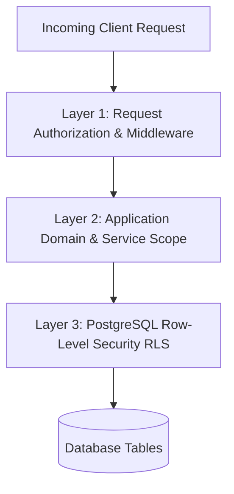

# Architecture Overview

## 1. System Vision

The AI Commerce Platform is designed as a **modular monolith** supporting multi-tenant commerce. Multiple independent stores operate securely on a single shared infrastructure. Each store receives an isolated customer base, catalog, order workflow, and administrative panel, while a super-admin panel oversees global tenants and platform metrics.

## 2. Multi-Tenant Isolation Strategy

Tenant isolation is enforced across three defensive layers:

1. **Layer 1: Request Authorization & Domain Mapping**
   - Public requests (Storefront) resolve the tenant via HTTP Host header or subdomain (never through user-supplied client query parameters).
   - Authenticated requests (Customer/Admin) validate JWT claims and tenant memberships.
2. **Layer 2: Application Domain & Service Scope**
   - Repositories and domain services accept an authenticated `TenantContext` and explicitly inject `tenant_id` into queries and inserts.
3. **Layer 3: PostgreSQL Row-Level Security (RLS)**
   - Tenant tables have PostgreSQL RLS enabled with `FORCE ROW LEVEL SECURITY`.
   - The API connects with a non-superuser role (`commerce_app`).
   - Every database transaction executes `SET LOCAL app.current_tenant_id = :tenant_id`, guaranteeing database-level data boundary enforcement even in the event of an application logic bug.

## 3. Modular Monolith Domain Design

Domains are grouped under `apps/api/app/domains/`:
- **Stores / Tenancy**: Tenant configuration, custom domains, branding.
- **Identity & Auth**: Global user identities, multi-store memberships, JWTs, refresh tokens, audit logs.
- **Catalog**: Products, categories, variants, inventory, media.
- **Cart & Checkout**: Cart session state, order placement, payments.
- **Orders**: Order processing, statuses, fulfillments.
- **Customers**: Profiles, saved addresses, store accounts.
- **Jobs**: Durable outbox-based transactional background jobs.
- **Storage**: Media asset storage abstraction (Local for development, Azure Blob for production).

Each domain encapsulates its own models, schemas, services, and endpoints, interacting with other domains strictly through defined interfaces or domain events.
